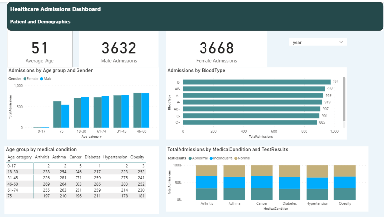
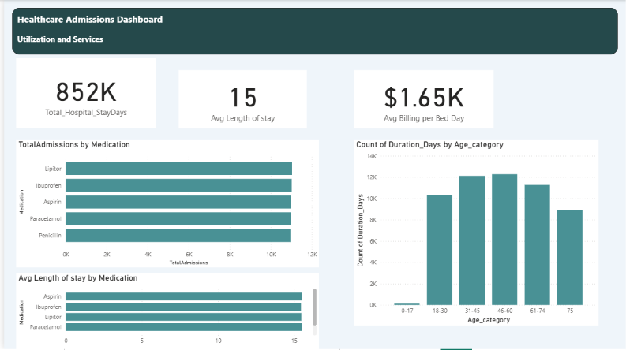
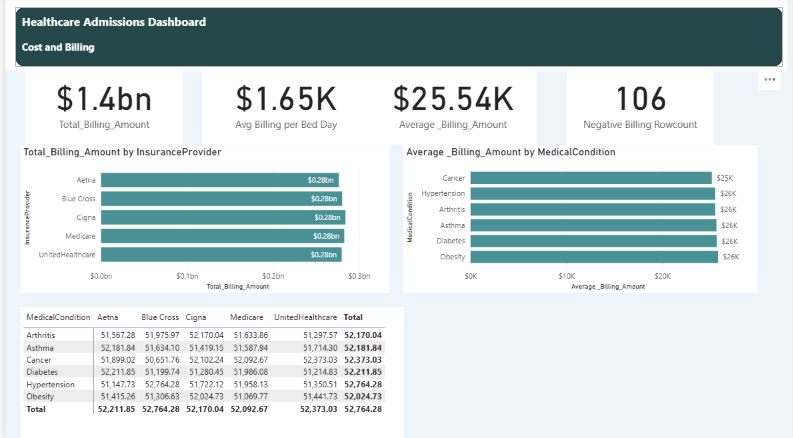

# Healthcare Admissions Dashboard | Power BI & MySQL

## Project Overview

I developed this Healthcare Admissions Dashboard as a portfolio project to apply my data analytics skills and gain hands-on experience working with healthcare data.

For this project, I analyzed a dataset containing 55,500 hospital admission records covering May 2019 to May 2024. My goal was to explore patient demographics, hospital admissions, healthcare utilization, and billing patterns using MySQL and Power BI.

Throughout this project, I worked on the complete data analytics workflow, including data profiling, data cleaning, data transformation, data modeling, DAX calculations, dashboard development, and business insights.

> **Note:** This is an independent portfolio project using a healthcare admissions dataset. It does not represent real hospital employment or operational healthcare analysis.

---

## Preview

| Executive Overview | Patient and Demographics |
|---|---|
|  |  |
| **Utilization and Services** | **Costs and Billing** |
|  |  |

---

## Project Objectives

I wanted to answer the following business questions through my analysis:

1. How many hospital admissions are recorded, what is the total billing amount, and how long do patients stay in the hospital?
2. What are the patient demographics, including age, gender, and blood type?
3. Which medical conditions account for more hospital admissions?
4. How are healthcare services and medications distributed across admissions?
5. How does billing vary across insurance providers and medical conditions?
6. What data-quality issues can I identify and investigate?

---

## Tools and Technologies

I used the following tools and technologies throughout this project:

- **MySQL 8:** Data profiling, data cleaning, SQL queries, data transformation, and validation.
- **Power BI Desktop:** Interactive dashboard development and data visualization.
- **Power Query:** Data transformation and preparation.
- **DAX:** Creating calculated measures and KPIs.
- **Excel:** Initial dataset review and exploration.

---

## My Project Workflow

### 1. Data Exploration and Profiling

I started by exploring the raw healthcare dataset to understand its structure, columns, data types, and overall quality.

The original dataset contained:
- 55,500 rows and 15 columns
- Hospital admission and discharge dates
- Patient demographics (age, gender, blood type)
- Medical conditions, medications, and test results
- Insurance providers and billing amounts

I performed initial data profiling to identify missing values, duplicate records, inconsistent text formats, unusual billing amounts, and date-related issues.

### 2. Data Cleaning Using MySQL

I used MySQL 8 to clean and prepare the dataset before building my Power BI report.

Some of the data-quality issues I identified and addressed were:

| Data Quality Issue | My Approach |
|---|---|
| 534 duplicate records | Removed exact duplicate rows using `SELECT DISTINCT` |
| Inconsistent name formats | Standardized names and removed titles and suffixes using `REGEXP_REPLACE` |
| Inconsistent blood type formats | Standardized text using `UPPER(TRIM(...))` |
| Hospital names with extra commas and leading words | Cleaned using four nested `REGEXP_REPLACE` calls |
| 106 negative billing records | Kept and flagged with `negative_billing_flag = 1` for further investigation |
| Missing values | Checked all columns; no missing values were identified |

After removing duplicates, I worked with 54,966 records for my analysis.

I kept negative billing amounts instead of deleting or changing them because the dataset did not explain whether they represented refunds, adjustments, or errors.

### 3. Data Modeling

After cleaning the data, I organized it into a star-schema data model in Power BI.

I created:
- A central `FactAdmissions` table
- Dimension tables for `Dim_Date`, `Dim_MedicalCondition`, `Dim_AdmissionType`, `Dim_Insurance`, `Dim_Age`, and `Dim_Hospital`
- One-to-many relationships between the fact and dimension tables in a single filter direction
- A dedicated `_Measures` table to organize my DAX calculations into display folders: Volume, Demographics, Utilization, Cost, Quality, and Time Intelligence

### 4. DAX Measures and KPI Development

I created DAX measures to calculate important healthcare metrics:

```dax
TotalAdmissions     = COUNTROWS ( FactAdmissions )
Total Billing       = SUM ( FactAdmissions[BillingAmount] )
Avg Billing         = DIVIDE ( [Total Billing], [TotalAdmissions] )
Total Bed Days      = SUM ( FactAdmissions[LengthOfStay] )
Avg Length of Stay  = DIVIDE ( [Total Bed Days], [TotalAdmissions] )
Billing per Bed Day = DIVIDE ( [Total Billing], [Total Bed Days] )
Emergency %         = DIVIDE ( CALCULATE ( [TotalAdmissions], FactAdmissions[AdmissionType] = "Emergency" ), [TotalAdmissions] )
```

The report also includes measures for male and female admissions, positive and negative billing, and negative billing rate.

### 5. Power BI Dashboard Development

I designed a four-page interactive Power BI dashboard to present my findings in an organized and understandable way.

| Page | What it shows |
|---|---|
| **Executive Overview** | KPI cards (admissions, total billing, average length of stay), admissions by medical condition and admission type, and a combined chart of admissions and billing over time with year/quarter/month drill-down. Slicers: year, admission type, medical condition, insurance provider. |
| **Patient and Demographics** | Average age, male and female admissions, admissions by age group and gender, blood type distribution, age group by condition matrix, and test results by condition (100% stacked). |
| **Utilization and Services** | Total bed days, average length of stay, billing per bed day, admissions and length of stay by medication, and bed days by age group. |
| **Costs and Billing** | Total billing, average billing, billing per bed day, negative billing amount, billing by insurance provider and by condition, and a condition by insurer matrix. |

I also incorporated interactive slicers, filters, and drill-down functionality to make the report easier to explore.

---

## Business Findings and Insights

The following findings are based on the cleaned dataset of 54,966 admission records.

### 1. Overall admission and billing overview

| Metric | Value |
|---|---|
| Total admissions | 54,966 |
| Total billing | ~$1.40 billion |
| Average billing per admission | ~$25,544 |
| Average length of stay | ~15.5 days |
| Total bed days | 851,934 |
| Annual admissions (full years 2020–2023) | ~11,000 |

> **Insight:** Admission volume remained relatively stable across the full calendar years analyzed.

### 2. Patient demographics and medical conditions

- Admissions were distributed relatively evenly across medical conditions.
- Age, gender, and blood type were explored to understand the patient population.
- The dataset showed limited variation in the distribution of medical conditions.

> **Insight:** No single medical condition represented a substantially larger share of admissions in this dataset.

### 3. Healthcare utilization and length of stay

- Admissions with a length of stay between 22 and 30 days accounted for approximately 30% of admissions.
- That same group accounted for approximately half of all total bed days.
- Billing per bed day decreased as length-of-stay categories increased.
- Billing amount and length of stay had a near-zero correlation of approximately -0.005.

> **Insight:** Longer stays consumed a disproportionately large share of available bed days, while billing did not increase proportionally with length of stay.

### 4. Billing and insurance analysis

- Total billing was distributed relatively evenly across insurance providers.
- Average billing and medical-condition billing patterns showed limited differences between categories.
- Negative billing was identified in 106 admissions, totalling approximately -$53,000.
- Negative billing records were distributed across all conditions and insurance providers.

> **Insight:** No insurance provider or medical condition showed a strong billing difference in this dataset. Negative billing records should be reviewed separately because their business meaning is not provided in the source data.

### 5. Overall business takeaways

- Admission volume was relatively stable during the full years analyzed.
- Patient conditions and insurance categories had similar admission distributions.
- Longer stays accounted for a large proportion of total bed days.
- Billing per bed day was lower among longer-stay categories.
- Negative billing records were a small proportion of the overall dataset and were retained for further investigation.

> **Overall conclusion:** The analysis highlights the importance of examining admission volume, patient demographics, healthcare utilization, length of stay, and billing together. The most notable pattern was the disproportionate use of bed days by longer-stay admissions. The dataset showed limited variation across several other categories, so the findings are reported without overstating differences.

---

## SQL Data Cleaning (MySQL 8)

Before building the Power BI report, the raw dataset was profiled and cleaned in MySQL 8 using `healthcare_mysql.sql`. The script follows a seven-section workflow.

### Workflow overview

| Section | What it does |
|---|---|
| 0 — Setup | Creates the `healthcare` database and the `raw_admissions` landing table. Loads the CSV with `LOAD DATA INFILE`. |
| 1 — Profiling | Row count, date range, missing values per column, distinct value counts, numeric min/avg/max, and category distributions. |
| 2 — Quality checks | Finds exact duplicates, negative billing, discharge-before-admission errors, text format issues, billing outliers (IQR), and name conflicts. |
| 3 — Cleaning | Writes `stg_admissions` using `SELECT DISTINCT` to drop duplicates, strips name titles and suffixes, uppercases blood type, and fixes hospital names. |
| 4 — Transformation | Builds `fact_admissions` with derived columns, four `dim_*` category tables, and a `dim_date` calendar table via recursive CTE. |
| 5 — Quality checks on clean data | Five pass/fail checks: no duplicates, no nulls in key fields, valid length of stay, every date in `dim_date`, no bad hospital names. |
| 6 — Reconciliation | Headline numbers (admissions, total billing, avg billing, avg LOS, bed days) to verify against Power BI KPI cards. |
| 7 — Analysis queries | Five queries that reproduce the logic behind each dashboard visual for independent verification. |

### How to run

1. Install [MySQL Community Server 8](https://dev.mysql.com/downloads/mysql/) (free).
2. Copy `healthcare_dataset.csv` to the folder returned by:
   ```sql
   SHOW VARIABLES LIKE 'secure_file_priv';
   ```
3. Open `healthcare_mysql.sql` in VS Code (with the Database Client extension) or MySQL Workbench.
4. Update the file path in the `LOAD DATA INFILE` statement to match your machine.
5. Run the script section by section from top to bottom.
6. Section 5 should return five `PASS` rows. Section 6 numbers should match the Power BI KPI cards.

### Key cleaning decisions in SQL

| Problem found | SQL approach |
|---|---|
| 534 exact duplicate rows | `SELECT DISTINCT` across all 15 columns in `stg_admissions` |
| Name titles (Mr., Dr.) and suffixes (MD, PhD) | `REGEXP_REPLACE` strips prefix and suffix patterns before `TRIM` |
| Hospital trailing commas and leading "and" | Four nested `REGEXP_REPLACE` calls, innermost to outermost |
| Blood type mixed casing (a+, B-) | `UPPER(TRIM(blood_type))` |
| Date subtraction for length of stay | `DATEDIFF(discharge_date, date_of_admission)` |
| No `generate_series` in MySQL | Recursive CTE with `DATE_ADD` builds the date dimension |
| No `PERCENTILE_CONT` in MySQL | `NTILE(4)` window function approximates Q1 and Q3 for IQR outlier check |
| No multi-column `COUNT(DISTINCT ...)` in MySQL | `COUNT(DISTINCT MD5(CONCAT_WS('\|', ...)))` hashes all columns for duplicate check |
| Negative billing amounts (106 rows, ~-$53k) | Kept and flagged with `negative_billing_flag = 1`, not deleted |

---

## Data Limitations

During my analysis, I identified several limitations that influenced how I interpreted the results:

- The dataset does not contain a unique patient ID, so I analyzed admission records rather than unique patients or readmissions.
- Billing amounts are not defined as charges, claims, or revenue, and there are no payment or denial fields.
- The dataset does not contain patient outcomes or diagnosis codes, limiting clinical outcome analysis.
- Hospital and doctor names were not suitable for meaningful rankings because most names were unique.
- The dataset showed very similar distributions across several categories, so I avoided making unsupported conclusions.

---

## What I Learned From This Project

Working on this project helped me strengthen my practical understanding of the data analytics process. Through this experience, I gained hands-on practice in:

- Profiling and cleaning data using MySQL
- Writing SQL queries for data validation and transformation
- Identifying and documenting data-quality issues
- Building a star-schema data model
- Creating DAX measures and KPIs in Power BI
- Designing interactive dashboards
- Analyzing healthcare admission, demographic, utilization, and billing patterns
- Translating analytical results into understandable business insights
- Recognizing data limitations and avoiding unsupported conclusions

---

## How to View My Project

1. Install [Power BI Desktop](https://powerbi.microsoft.com/desktop/) (free, Windows).
2. Download `health.pbix` from this repository and open it.
3. If the data source path is not found, go to **Home > Transform data > Data source settings** and point it to your copy of the dataset.

---

## Repository Contents

```
health.pbix              Power BI report
healthcare_mysql.sql     MySQL profiling, cleaning and analysis script
README.md                Project documentation
images/                  Dashboard screenshots
```

---

## Skills Demonstrated

MySQL 8 (data profiling, cleaning, star-schema transformation, window functions, recursive CTEs, regex), Power BI Desktop, Power Query, DAX, star-schema data modelling, KPI and dashboard design, slicers and drill-down, data quality documentation, healthcare analytics.

---

## Author

**Sangeetha Prabu**


