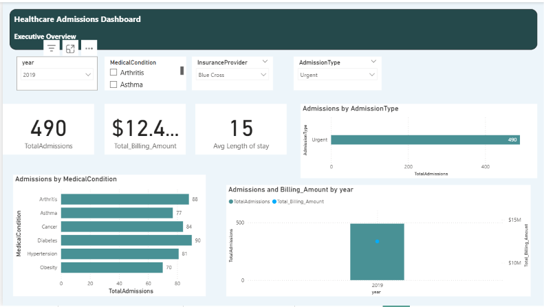

# Healthcare Admissions Dashboard (Power BI)

An interactive four-page Power BI report that analyses 54,966 hospital admissions (May 2019 to May 2024): volume, patient mix, length of stay and billing. The project covers the full workflow of a BI analyst: profiling and cleaning raw data, building a star-schema model, writing DAX measures and designing a dashboard for non-technical users.

> Portfolio project built on a healthcare admissions dataset. It is not real hospital operations work, and the findings are limited by what the data contains (see [Limitations](#limitations)).

## Preview

Add your screenshots to a `/images` folder and link them here:

| Executive Overview | Patient and Demographics |
|---|---|
|  |  |
| **Utilization and Services** | **Costs and Billing** |
|  |  |

## Business questions

1. How many patients were admitted, what did it bill, and how long did patients stay?
2. Who are the patients (age, gender, blood type), and which conditions do they have?
3. How are services used: which medications, how long are stays, and where are bed days spent?
4. How does billing vary by insurance provider and medical condition?

## Dashboard pages

| Page | What it shows |
|---|---|
| **Executive Overview** | KPI cards (admissions, total billing, average length of stay), admissions by medical condition and admission type, and a combined chart of admissions and billing over time with year/quarter/month drill-down. Slicers: year, admission type, medical condition, insurance provider. |
| **Patient and Demographics** | Average age, male and female admissions, admissions by age group and gender, blood type, an age group by condition matrix, and test results by condition (100% stacked). |
| **Utilization and Services** | Total bed days, average length of stay, billing per bed day, admissions and length of stay by medication, and bed days by age group. |
| **Costs and Billing** | Total billing, average billing, billing per bed day, negative billing amount, billing by insurance provider and by condition, and a condition by insurer matrix. |

## Data

- **Source:** one Excel sheet, 55,500 rows and 15 columns: patient name, age, gender, blood type, medical condition, admission and discharge dates, doctor, hospital, insurance provider, billing amount, room number, admission type, medication, and test results.
- **Grain:** one row is one admission. The file has no patient ID, so the dashboard counts admissions, not unique patients.

### Data quality findings and decisions

| Issue found | Count | Decision |
|---|---|---|
| Exact duplicate rows | 534 | Removed (55,500 to 54,966 rows) |
| Missing values | 0 | None needed |
| Inconsistent name casing and titles (Mr., Dr., MD, PhD) | 55,467 / 1,944 | Standardised |
| Hospital names with stray commas or leading "and" | 4,776 / 5,749 | Cleaned |
| Negative billing amounts | 106 after de-duplication (about -$53k) | **Kept and flagged**, shown in separate measures. Meaning is not stated in the data (refund, adjustment or error), so they were not deleted or sign-flipped. |
| Hospital and doctor names | about 40,000 distinct each | Not used for rankings: names are almost all unique and have no ID |
| Partial periods | May 2019 and May 2024 | Treated as partial, not as drops |

Derived fields: length of stay (discharge date minus admission date), age category, and a date table.

## Data model

Star schema: one fact table (`FactAdmissions`) with one-to-many relationships from dimension tables (`Dim_Date`, `Dim_MedicalCondition`, `Dim_AdmissionType`, `Dim_Insurance`, `Dim_Age`, `Dim_Hospital`) in a single filter direction. Measures live in a dedicated `_Measures` table, organised in display folders: Volume, Demographics, Utilization, Cost, Quality and Time Intelligence.

## Key measures (DAX)

```dax
TotalAdmissions    = COUNTROWS ( FactAdmissions )
Total Billing      = SUM ( FactAdmissions[BillingAmount] )
Avg Billing        = DIVIDE ( [Total Billing], [TotalAdmissions] )
Total Bed Days     = SUM ( FactAdmissions[LengthOfStay] )
Avg Length of Stay = DIVIDE ( [Total Bed Days], [TotalAdmissions] )
Billing per Bed Day = DIVIDE ( [Total Billing], [Total Bed Days] )
Emergency %        = DIVIDE ( CALCULATE ( [TotalAdmissions], FactAdmissions[AdmissionType] = "Emergency" ), [TotalAdmissions] )
```

The report also has measures for male/female admissions, positive and negative billing, and negative billing rate. Column and measure names in the `.pbix` may differ slightly from the simplified names above.

## Key findings

All figures are from the cleaned data (54,966 admissions).

- **Scale:** about $1.40B total billing, an average of about $25,544 per admission, and an average stay of 15.5 days (851,934 bed days).
- **Stable volume:** about 11,000 admissions a year in full years (2020 to 2023).
- **Very even mix:** conditions, insurers, admission types and medications each hold similar shares, and billing, length of stay and test results barely differ between groups (typically within about 3%). There is no strong segment to target.
- **Billing does not rise with length of stay** (correlation about -0.005), so billing per bed day falls from about $6,400 for 1 to 7 day stays to about $980 for 22 to 30 day stays.
- **Long stays take the beds:** stays of 22 to 30 days are about 30% of admissions but about half of all bed days.
- **Negative billing is small and spread out:** 106 admissions, about -$53k, across all conditions and insurers.

## Limitations

- No patient ID, so no readmission or unique-patient analysis.
- Billing Amount is not defined in the file (charge, claim or revenue), and there are no payment or denial fields, so claims analysis is not possible.
- No outcomes, diagnosis codes, departments or locations, so no quality-of-care or geographic analysis.
- Hospital and doctor names are not reliable dimensions.
- The dataset shows almost no variation between categories, so the dashboard reports "no material difference" instead of manufacturing insights.

## How to open

1. Install [Power BI Desktop](https://powerbi.microsoft.com/desktop/) (free, Windows).
2. Download `health.pbix` from this repository and open it.
3. If the data source path is not found, go to **Home > Transform data > Data source settings** and point it to your copy of the dataset.

## Skills demonstrated

Power BI Desktop, Power Query (data profiling and cleaning), DAX, star-schema data modelling, KPI and dashboard design, slicers and drill-down, data quality documentation, healthcare analytics.

## Repository contents

```
health.pbix        Power BI report
README.md          This file
images/            Dashboard screenshots
```

## Author

Sangeetha Prabu
